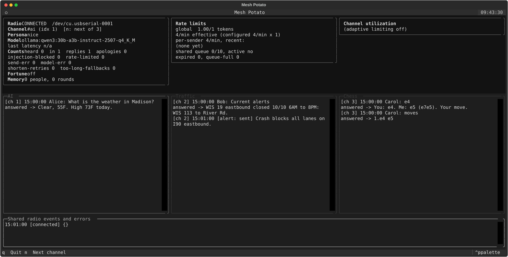

# Mesh Potato

[](https://www.python.org/)
[](LICENSE)
[](docs/manual.md#development)

A chat bot for [MeshCore](https://meshcore.co.uk) LoRa mesh channels. It runs on
a computer with a MeshCore companion radio on USB, answers questions with a
language model running on that same computer, and replies in one sentence that
fits a 160-byte radio packet. No cloud account, no web server, no database to
run. A live instance answers on `#ai` in southern Wisconsin, centered on Madison.



## What it does

- **Answers on the air.** Ask "What does spreading factor change?" or "Why is
  the sky blue?" and get one short sentence back as `@[you] answer`. It
  remembers your recent exchanges, so "explain that more simply" works. When
  earlier exchanges exist under the same sender name, greetings preserve that
  continuity; first-meeting wording is rejected and retried within the usual
  generation budget. Different sender names keep separate memories.
- **Knows the mesh it lives on.** It reads its own frequency, bandwidth and
  power from the radio, carries a small sourced LoRa reference, and can explain
  how your message reached it from that packet's hop count, RSSI and SNR.
  Its reference material distinguishes MeshCore from Meshtastic, including their
  separate protocols and routing behavior. Short challenges such as "is that
  wrong?" recheck the preceding exchange against the relevant reference facts.
- **Looks things up.** Weather, scores, prices, news and other changing facts
  trigger a web lookup with a source domain, or an honest "could not verify".
  Daily weather comes as a compact one-line forecast. If a location cannot be
  found, the reply says weather information is unavailable for that location;
  service failures receive a separate retry notice.
  Locations accept `Madison WI` and `NYC`, including natural questions such as
  `What’s the weather in Madison WI?`. Within two minutes of a weather reply,
  a location follow-up such as `Okay, how about NYC?` fetches a new forecast,
  including after an unsuccessful lookup. Context belongs to that sender and
  clears on a topic change or `/forget`. After a location clarification, a
  missing US state also works. A state alone, such as `NY`, asks for a city;
  `NYC` selects New York City. Moon weather questions get a
  [NASA-based explanation](https://science.nasa.gov/moon/weather-on-the-moon/)
  of lunar surface temperatures, rather than an Earth city lookup or a claim
  to have a current lunar measurement.
  Sports questions support ALCS, NLCS and World Series games, plus short
  follow-ups such as "next game?" and "what's the score?" after a team lookup.
  "What time is the Brewers game?" checks today's game; "next game" checks
  the upcoming schedule. Times and scores come from verified ESPN feed fields.
- **Plays chess.** An optional `#chess` channel runs Stockfish with saved games
  per player, adjustable difficulty, hints, draw claims and move history.
- **Reports traffic.** An optional `#traffic` channel announces serious
  Wisconsin 511 incidents and closures. `/reports` sends up to five numbered reports, each
  in its own message, spaced two seconds apart after the first. The whole batch
  uses one normal request allowance; congestion pauses still apply. The final
  report omits "End of reports" when that space is needed for the closure text. `/cont` requests
  the next group if there are more. `/help` explains how to read them, and `/examples`
  gives travel-time requests to try. Ordinary questions such as "How's the Beltline?"
  work without a command prefix and return cached travel times. With Dane County selected, it also reads official
  Madison transportation notices for major local street and event closures.
  Useful city notices can be announced up to 180 days ahead. Repeated polls stay
  quiet; a genuinely new notice in the final 24 hours can produce one reminder
  if the previous announcement was at least 48 hours earlier. Corrections,
  explicit cancellations, postponements and confirmed reopening are tied to what
  the channel previously announced. Minor city restrictions are available on request.
  Routine congestion stays quiet.
  `traffic_madison_enabled = false` disables the city source;
  `traffic_madison_preview = true` logs proposed city announcements without sending
  them or consuming announcement receipts. `/details` gives the source for the report just read.
  City notices are published plans, not live measurements: unclear dates or scope
  are omitted, phased work retains its qualifications, and a notice disappearing
  never means a road reopened. Sources refresh independently; `/status`
  identifies fresh, partial or unavailable coverage. Partial coverage can reflect
  fetch failures, parsing errors or notices whose dates or scope cannot be verified;
  it does not mean the pages are missing. The older Madison ArcGIS closure layer is archival and is
  not used. See [traffic coverage and limitations](bot/traffic/README.md#madison-closure-notices)
  for matching rules, supported updates and freshness limits.
  Long 511 alerts keep the alert type and an excerpt of the actual details, with
  `511wi.gov` for the rest. Equivalent reports with different source IDs are
  announced once. A recently fetched report of zero delay says "No delays reported by 511,"
  even if its source timestamp is older. Missing data never means no delays. Other
  old travel times are marked "current unavailable" with their source timestamps.
- **Has personalities.** Nice by default; `/funny`, `/snarky`, `/marvin`,
  `/pirate`, `/haiku` and `/serious` on request, reverting after two hours.
  A silly fortune arrives a little after six every morning.
  Changing the scheduled tips or the bot's software requires its operator;
  a chat reply cannot make those changes.
- **Treats the channel as hostile.** Every incoming line, the assembled
  context and every outgoing reply pass a sub-millisecond prompt injection
  detector before they can reach the model or the radio.
- **Is polite on the air.** It targets about 2 percent of channel time for its
  own transmissions and measures that from the radio's airtime counters. Ordinary
  replies are spaced at least 15 seconds apart under the default limits. Requested
  traffic batches use two-second gaps within the batch. Congestion can delay both.
- **Watches itself.** A terminal monitor shows each channel, the shared radio,
  rate limits and every decision. Monitor timestamps use the computer's local
  time with a time zone label; the shared radio events and errors panel also
  shows the date. JSON logs retain UTC timestamps for services.

Everything runs locally: a local model through Ollama or any OpenAI-compatible
endpoint, a SQLite file for memory, and a Python package with a test suite that
needs no radio, model or network.

## Quick start

```bash
git clone https://github.com/mhcoen/meshpotato.git meshpotato
cd meshpotato
uv venv --python 3.12
uv pip install -e '.[dev]'
ollama pull qwen3:30b-a3b-instruct-2507-q4_K_M
cp config.example.toml config.toml   # set port, channel_idx, bot_name
.venv/bin/meshpotato --config config.toml
```

You need a Mac or Linux computer that stays on (an old laptop is ideal, 32 GB of
RAM or more for the default model), a MeshCore companion radio on USB with a
node name equal to `bot_name`, Python 3.11 or newer, and
[Ollama](https://ollama.com). The radio must already have your regional preset
and the channel it will serve; see
[Prepare the radio](docs/manual.md#prepare-the-radio).

Then say something on the channel. `/help` lists commands. Press `q` to quit
the monitor, or run with `--headless` as a service.

## Going further

- [The manual](docs/manual.md): installation in detail, radio setup, every
  configuration key, how a message is handled, rate limits, security,
  troubleshooting and development.
- [#chess](docs/chess/README.md): setup, commands, difficulty levels and how
  games survive restarts and lost packets.
- [#traffic](bot/traffic/README.md): the 511 API key, Madison notices, announcement
  rules, and how to browse current alerts.
- [Configuration reference](docs/configuration.md) and the
  [example config](config.example.toml).

## License

MIT; see [LICENSE](LICENSE). Search and extraction code adapted from [Episodic](https://github.com/mhcoen/episodic)
retains its [Apache-2.0 license](bot/EPISODIC-LICENSE).

**Michael H. Coen**, W1MHC/WRYV459. mhcoen@gmail.com | mhcoen@alum.mit.edu
